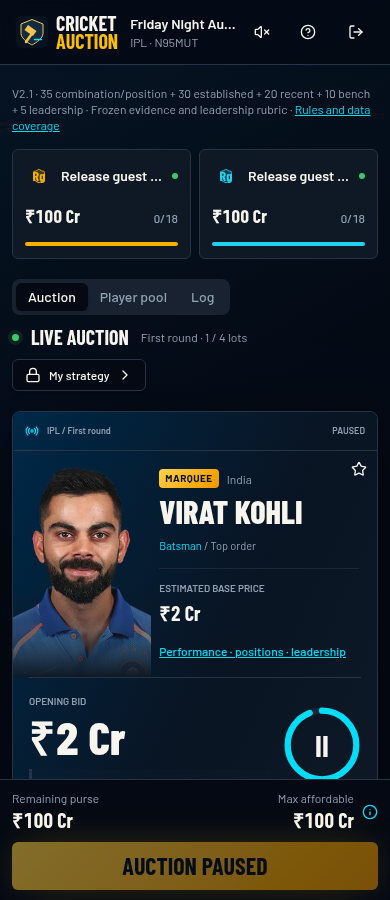
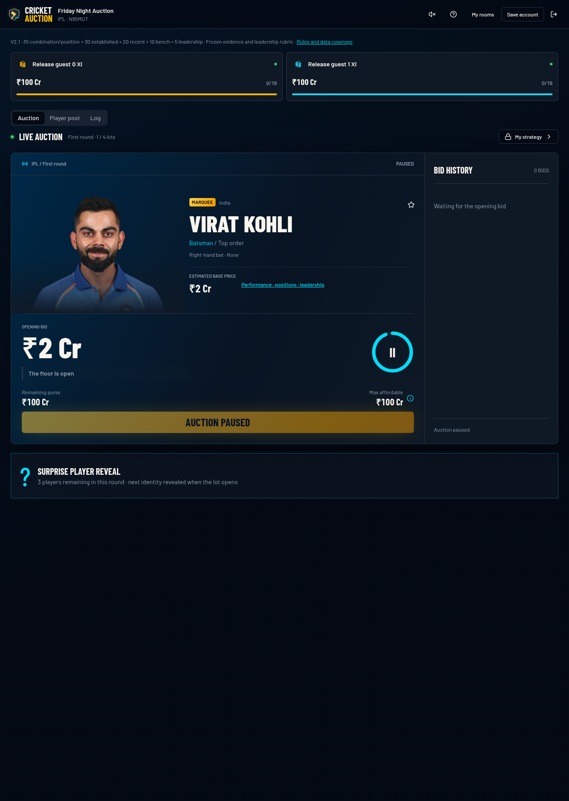
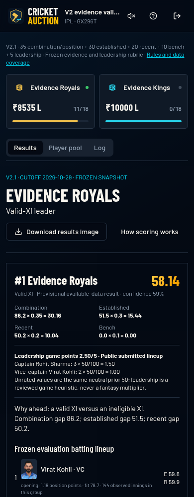
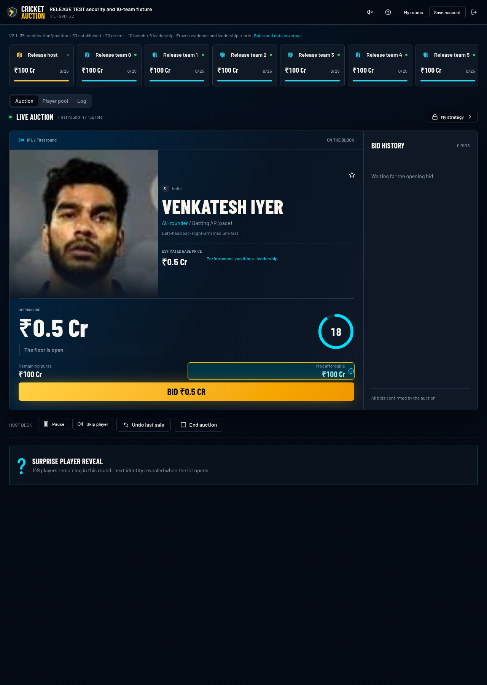

# Cricket Auction

A real-time, mobile-first multiplayer cricket player auction. A host creates a room and shares a 6-character code; friends join as guests, review a confirmed player pool, bid live against server-enforced timers and purses, trade players, set a public batting order with Captain/Vice-Captain, and compare teams using a transparent evidence-based evaluation.

Developed with AI assistance using [Lovable](https://lovable.dev).

## Screenshots

| Phone (390px) | Laptop (1280px) | Results | 10-team auction |
| --- | --- | --- | --- |
|  |  |  |  |

SOLD/UNSOLD overlays: [`docs/post-launch-evidence/`](docs/post-launch-evidence/). Screenshots show sourced player portraits — see licensing limitations below.

## Features

- **Rooms:** create/join by code, 2–10 teams, team colours, host transfer, device-persistent guest accounts with optional email linking.
- **Pool review:** balanced pool builder (role/spin/pace quotas), shared confirmation, then a server-shuffled random order frozen once at auction start. Optional *surprise reveal* (default on) hides the future queue from the network as well as the UI.
- **Live auction:** server-validated bid steps, purse/max-affordable-bid guard, squad size and overseas limits, database-held deadlines, auto-pause when everyone disconnects, SOLD/UNSOLD reveals and a persistent “Last sold” card.
- **Host controls (rooms created after the post-launch repair):** pause/resume/skip, *Undo last bid* separate from *Undo last sale* (with refund), next-lot timer settings, unlimited reshuffled unsold rounds, a Final Call stage where teams nominate unsold players, and Close auction & open trades.
- **Trades:** proposals/counters with players and cash, atomic acceptance; trading closes auction purchases.
- **Evaluation:** room-frozen scoring versions. Current rooms use V2.1: 35% XI combination, 30% established performance, 20% recent form, 10% bench, 5% leadership (`3×C/100 + 2×VC/100`). Inputs come from imported [Cricsheet](https://cricsheet.org) scorecards (aggregates and observed batting-position arrivals). Older rooms keep V1/V2.0 results unchanged. The seeded legacy rating is display-only and not a V2 input.
- **Private strategy:** per-user notes, targets and draft XI visible only to their owner.
- **Admin (owner only):** player/photo editing and evidence import, gated by `public.user_roles`.

## Stack

- TanStack Start v1 (React 19, TypeScript, Vite 8, SSR + server functions).
- Tailwind CSS v4 with semantic design tokens; shadcn/Radix UI components.
- Lovable Cloud backend (Supabase): Postgres, Auth (anonymous guests + email), Realtime, Storage (private photo bucket), Row Level Security.
- Tests: Vitest + Testing Library; Python importer tests; Python/Playwright integration scripts.

## Architecture and server authority

- **All game mutations are `SECURITY DEFINER` Postgres functions** that lock the room row (`FOR UPDATE`) with a fixed `search_path`. Clients have no INSERT/UPDATE/DELETE grants on game tables; anon has no table access.
- **Bids are bound** to the observed lot ID, a monotonic `lot_version` and a unique request ID, so a delayed or retried bid cannot land on the next lot or apply twice. Host commands bind to observed status/version/revision (and sale ID for undo) and are idempotent via a command log.
- **Time is server-owned:** deadlines live in the database; clients call `tick` only after a deadline, using a skew-corrected server clock.
- **Scoring is server-computed:** trusted server functions score persisted holdings and lineups against frozen evidence snapshots and commit one fingerprint-checked result shared by all participants; clients never submit scores.
- **Reads:** member-only projections (full and lean) through one single-flight read coordinator; Realtime is used as a revision “doorbell”, not to stream base tables.
- **Abuse limits:** bounded settings/text/import sizes via table and RPC guards, persisted per-user action quotas, request-body cap on the server.
- Rule logic in `src/lib/auction-rules.ts` is mirrored in SQL. Migrations live in `drizzle/migrations/`. Further design rules: [`AGENTS.md`](AGENTS.md).

## Setup

Requirements: [Bun](https://bun.sh), a Supabase-compatible backend with the migrations in `drizzle/migrations/` applied, anonymous sign-ins enabled, and the player catalogue/evidence data loaded (see `src/data/` and `scripts/`).

```bash
cp .env.example .env.local   # public VITE_ values only; .env.local is git-ignored
bun install
bun run dev
```

Environment variables (see `.env.example`):

- `VITE_SUPABASE_URL`, `VITE_SUPABASE_PUBLISHABLE_KEY`, `VITE_SUPABASE_PROJECT_ID` — **public** browser config. The publishable key is designed to ship in the frontend bundle; access is enforced by RLS and function checks.
- `SUPABASE_URL`, `SUPABASE_PUBLISHABLE_KEY` — same values for server-side rendering.
- `SUPABASE_SERVICE_ROLE_KEY` — **private**, server-only, required at runtime by trusted evaluation functions.

Keep the managed, tracked `.env` unchanged. The Vite config only loads `VITE_`-prefixed values from env files, so the server variables (`SUPABASE_URL`, `SUPABASE_PUBLISHABLE_KEY`, `SUPABASE_SERVICE_ROLE_KEY`) are read from the real process environment. Supply them from your shell or a secret manager when starting the server, for example:

```bash
export SUPABASE_URL=... SUPABASE_PUBLISHABLE_KEY=... SUPABASE_SERVICE_ROLE_KEY=...
bun run dev
```

Never put the service-role key in the tracked `.env`, any committed file, or a `VITE_`-prefixed variable (those are bundled into the browser).

On Lovable these are managed automatically. Code export does **not** copy the backend (database, auth users, storage) — see [`docs/GITHUB-EXPORT.md`](docs/GITHUB-EXPORT.md).

Owner admin is never auto-granted; insert an `admin` row into `public.user_roles` for your own user via a trusted database session.

## Tests

```bash
bunx vitest run                              # unit/UI tests
python3 src/test/cricsheet-import.test.py    # importer tests
python3 src/test/positions-import.test.py
bun run build
```

Run on 2026-11-02 for this documentation commit: Vitest **69 passed (11 files)**; both importer test files **OK**.

`src/test/*.integration.py` and `scripts/test-*` are integration/browser scripts that require a running app and a disposable isolated backend; their results are historical and recorded in [`docs/RELEASE-AUDIT.md`](docs/RELEASE-AUDIT.md) and [`docs/POST-LAUNCH-FIXES.md`](docs/POST-LAUNCH-FIXES.md). They were not rerun for this commit. No load/scalability benchmark is claimed beyond what those reports measured in their stated environments.

## Known limitations

- **Player portraits:** most are editorial provider images with no verified redistribution licence. Attribution is not permission. Replace or obtain permission before any public redistribution. Portrait quality is uneven; many originals are low resolution.
- **Leadership ratings:** all entries use disclosed neutral 50 priors pending owner review; no ratings were invented.
- **Data coverage is incomplete** (some players lack IPL/ODI evidence or batting-position data); the UI labels coverage and provisional values.
- **Automatic lineup selection** is an approximate solver and is labelled as such.
- Positive owner/admin flows were only verified in isolated test fixtures, not against a production admin account.

## Licences and attribution

Match data: Cricsheet, see [`docs/CRICSHEET-LICENSE.txt`](docs/CRICSHEET-LICENSE.txt). Portrait sources and credits are recorded in `src/data/player-photos.json` and `src/lib/portrait-improvements.ts`. No licence is granted for third-party assets; the repository has no blanket open-source licence.
